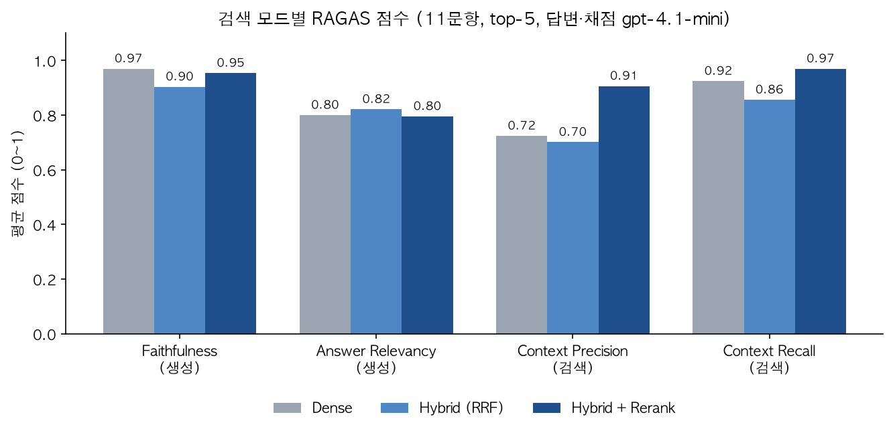

# AI·반도체 정책 리포트 RAG

> Dense → Hybrid(BM25 + RRF) → Rerank 단계별 검색 품질 비교
> SKALA 「생성형 AI 서비스 개발 · Vector DB」 실습을 확장한 개인 프로젝트

## 무엇을 만드나
AI·반도체 관련 공공·민간 보고서 16개(약 860페이지)를 검색 가능한 벡터 DB로 만들고,
"HBM" 같은 고유명사 질문에서 의미 검색(Dense)이 놓치는 부분을 키워드 검색(BM25)과 Reranker로 보완하는 과정을 수치로 비교한다.

## 데이터
| No | 문서 | 발행처 |
|---|---|---|
| 1 | SPRi AI Brief (2025.01 ~ 2026.06, 12개 호) | 소프트웨어정책연구소 |
| 2 | 인공지능(AI) 실행전략 (2020) | 한국전자통신연구원 |
| 3 | 글로벌 반도체 산업 전망 2026 | 삼일PwC |
| 4 | AI 반도체 강국도약 가이드라인 (2025) | 반도체특별위원회 |
| 5 | AI 반도체 기술 및 산업 동향 (2024.07) | KDB미래전략연구소 |

※ 원문 PDF는 저작권상 레포에 포함하지 않음. `data/pdfs/`에 직접 넣어서 사용.

## 파이프라인
```
PDF 16개 → 로딩·전처리 → 청킹(500자/50자 오버랩) → BGE-M3 임베딩
        → FAISS(실험) / Qdrant(메타데이터 필터)
        → BM25 + RRF(Hybrid) → BGE-Reranker → RAGAS 평가
```

검색 함수는 `src/rag_search.py`에 모듈로 분리되어 있다(`search(query, k, mode, category, year_gte)`, mode = dense / bm25 / hybrid / rerank).

## 진행 상황
- [x] 01. PDF 로딩 · 전처리 · 청킹 (`notebooks/01_vectordb_basics.ipynb`)
- [x] 02. 임베딩 · FAISS · Qdrant · 필터 검색 (`notebooks/02_embedding_faiss_qdrant.ipynb`)
- [x] 03. BM25 · RRF Hybrid · Reranker (`notebooks/03_hybrid_rerank.ipynb`)
- [x] 04. RAGAS 평가 · Before/After 비교 (`notebooks/04_ragas_eval.ipynb`)

## 전처리에서 신경 쓴 점
- 16개 문서 전체 로딩 + 메타데이터(source, publisher, category, year, page) 부착
- 문서 내 30% 이상 페이지에 반복되는 짧은 줄을 머리글·꼬리글로 자동 판단해 제거
- macOS 한글 파일명(NFD) → NFC 정규화 (필터 검색 0건 문제 예방)
- 100자 미만 페이지(표지·구분 페이지) 제외

## 결과

### 03. 검색 근사 평가 (15문항, 키워드 포함 여부, API 비용 없음)
| 방식 | P@5 | MRR@10 | 최저 P@5 | 질문당 시간 |
|---|---|---|---|---|
| Dense (BGE-M3) | 0.693 | 0.944 | 0.0 | 34ms |
| BM25 (공백 토큰화) | 0.653 | 0.933 | 0.0 | 0.03ms |
| BM25 (한글 bigram 토큰화) | 0.800 | 0.956 | 0.2 | 0.03ms |
| Hybrid (RRF) | 0.787 | 0.967 | 0.2 | 33ms |
| **Hybrid + Rerank** | **0.867** | 0.967 | **0.4** | 약 650ms |

### 04. RAGAS 답변 품질 평가 (11문항 × 3모드, top-5, 답변·채점 gpt-4.1-mini)
| 방식 | Faithfulness | Answer Relevancy | Context Precision | Context Recall | 평균 | 근거청크 적중 |
|---|---|---|---|---|---|---|
| Dense | 0.970 | 0.800 | 0.724 | 0.924 | 0.854 | 68% |
| Hybrid (RRF) | 0.904 | 0.821 | 0.701 | 0.856 | 0.820 | 66% |
| **Hybrid + Rerank** | 0.954 | 0.795 | **0.906** | **0.970** | **0.906** | **86%** |

> 평가 세트: 교재 질문 4개 + 03에서 Dense가 약했던 고유명사 질문 7개. reference는 원문 청크를 근거로 LLM이 초안 작성 → 본인 검토·수정, 근거 source/page 함께 저장 (`outputs/ragas_eval_set.json`)



### 핵심 인사이트
- **Rerank의 효과는 검색 쪽에서 나온다.** Context Precision이 0.72에서 0.91로, 근거 청크 적중률이 68%에서 86%로 올랐다. 생성 쪽 지표는 거의 그대로라서, 이 구성에서는 **병목이 생성이 아니라 검색**이다.
- **Hybrid(RRF)는 평균으로는 Dense와 차이가 없다.** 4지표 평균 차이 −0.034는 이 README의 노이즈 기준(±0.05) 안이다(Q06을 빼면 +0.013). 대신 BM25 쪽 노이즈가 RRF로 끌려 올라와 근거를 통째로 놓치는 사례가 생긴다(Q06 퓨리오사AI: CP·CR 0.00, 오답). Reranker를 붙이면 이런 실패가 보완된다(Q06 CP 0.92, Faithfulness 1.00).
- **한국어에서는 토크나이저와 평가 도구 모두 기본값 그대로 쓰면 안 된다.**
  - 공백으로만 자르는 BM25는 "HBM이란"을 하나의 단어로 봐서 검색 결과가 0개였다. 한글 bigram 토크나이저로 바꾸자 P@5가 0.65에서 0.80으로 올랐다.
  - RAGAS는 영어로 질문을 역생성해 Answer Relevancy가 언어 차이로 깎였다(0.48). 채점 LLM에 한국어 지시를 주니 0.68로 정상화됐다.
- **키워드 근사 지표와 RAGAS는 모드 순위만 같다.** 질문 단위 상관은 0.11로 거의 무관했다. 반면 "근거 청크를 가져왔나"와 Context Recall의 상관은 0.84였다. 빠른 점검은 키워드 지표로 하고, 최종 판단은 근거 기반 지표로 해야 한다.

## 실행 방법
```bash
uv sync                      # 가상환경 + 패키지 설치
docker run -d --name qdrant -p 6333:6333 \
  -v "$(pwd)/qdrant_storage:/qdrant/storage" qdrant/qdrant

# 04(RAGAS)용 OpenAI API 키: 프로젝트 루트에 .env 파일 생성 (.gitignore에 포함되어 커밋되지 않음)
echo "OPENAI_API_KEY=sk-..." > .env

# VS Code에서 notebooks/ 노트북을 01 → 04 순서로 열고 커널을 .venv로 선택
```
- 04는 OpenAI API를 사용한다(11문항 전체 첫 실행 약 377회 호출, 약 $0.29). 답변과 점수는 `outputs/`에 캐시되어 재실행하면 API를 다시 호출하지 않는다.
- 노트북 설정 셀의 `RUN_QIDS = ["Q01", "Q05"]`로 일부 질문만 먼저 테스트할 수 있다.
- macOS 주의: torch(FlagEmbedding)를 faiss보다 먼저 import해야 하고, faiss는 `omp_set_num_threads(1)`로 실행한다. libomp 충돌로 커널이 죽는 문제를 막기 위해서다.

## 기술 스택
Python 3.11 · PyMuPDF · LangChain Text Splitters · BGE-M3 · FAISS · Qdrant · bm25s · BGE-Reranker · RAGAS · OpenAI (gpt-4.1-mini)

## RAG 설정 시 고려사항 (개인 의견, 초안)
이번 실험 결과를 근거로 정리한 생각이다. 11~15문항 규모의 실험이라 일반화에는 한계가 있다.

1. **검색 개선이 먼저다.** 생성 쪽 지표(Faithfulness 0.90~0.97)는 처음부터 높았고, 점수 차이는 대부분 검색에서 났다. 프롬프트나 LLM을 바꾸기 전에 "필요한 근거를 top-k에 가져오는가"부터 측정하고 개선하는 게 효율적이다.
2. **Hybrid는 Reranker와 한 세트로 쓴다.** RRF만 썼을 때 평균은 Dense와 차이가 없었다(−0.034, 노이즈 범위). 하지만 RRF는 한쪽 검색의 노이즈도 순위만 보고 끌어올려서, Q06처럼 근거를 통째로 놓치고 오답을 내는 사례가 생겼다. 평균을 올리는 것보다 이런 "큰 실패"를 막는 것이 Reranker의 역할이었다. Reranker 후보 수는 20개가 정확도와 속도의 균형점이었다(30개와 정확도는 같고 1.5배 빠름).
3. **Reranker의 비용은 지연 시간이다.** 질문당 약 34ms에서 약 650ms로 늘었다(M5 MPS). 실시간 서비스라면 후보 수를 줄이거나, Rerank를 고유명사가 섞인 질문에만 적용하는 방식을 검토할 만하다.
4. **한국어는 토크나이저부터 확인한다.** 띄어쓰기 기준 BM25는 조사 때문에 무력화된다. 형태소 분석기가 없어도 "한글·영문 분리 + 한글 bigram"만으로 큰 개선이 있었다. 띄어쓰기가 사라진 PDF(삼일PwC)에도 효과가 있었다.
5. **표가 많은 문서는 청킹 전에 표를 따로 처리해야 한다.** 표가 줄 단위로 풀린 청크 때문에 LLM이 행과 열을 잘못 이어 읽고 오답을 냈다(퓨리오사AI 사례). 표 구조를 살리는 추출 도구나 표 전용 청킹이 다음 개선 과제다.
6. **메타데이터 필터는 Dense와 BM25 양쪽에 같이 걸어야 한다.** 한쪽에만 걸면 RRF 과정에서 조건 밖의 청크가 섞여 들어온다. "검색 후 거르기"는 결과 수가 부족해지므로 "검색하면서 거르기"(Qdrant 필터, BM25 mask)가 맞다.
7. **평가는 여러 지표로 교차해서 본다.**
   - Answer Relevancy는 내용이 틀려도 형식만 맞으면 높고, Context Precision은 정답 청크를 놓고도 낮게 판정한 경우가 있었다.
   - 검색 쪽(CP·CR)과 생성 쪽(F·AR)을 나눠서 보고, 점수가 이상한 질문은 실제 청크와 답변을 열어 확인해야 한다.
   - 채점 LLM은 temperature=0이어도 결과가 흔들려서 ±0.05 차이에는 의미를 두지 않는다.
8. **평가 결과는 캐시하고 비용을 기록한다.** 채점이 API 비용의 90%를 차지했다. 같은 조건에서 재실행할 때 점수가 바뀌지 않도록, 그리고 비용이 반복해서 나가지 않도록 답변과 점수를 입력값 해시 기준으로 저장했다.
